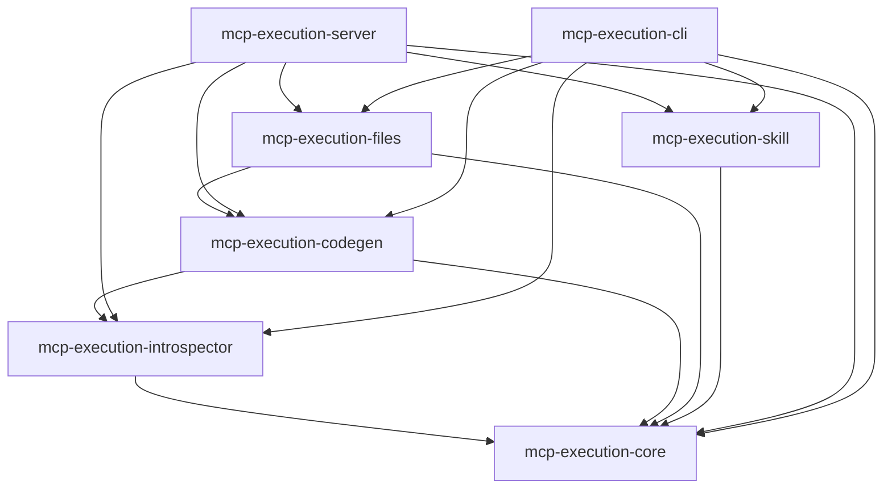

---
aliases:
  - Specifications Index
  - mcp-execution Specs Overview
  - MOC-specs
tags:
  - moc
  - sdd
created: 2026-07-27
status: moc
related:
  - "[[constitution]]"
  - "[[BRD-mcp-execution-2026-07-27]]"
  - "[[SRS-mcp-execution-2026-07-27]]"
  - "[[NFR-mcp-execution-2026-07-27]]"
---

# mcp-execution — Specification Package

> [!abstract]
> This is a **reverse-engineering documentation pass** over the existing
> `mcp-execution` codebase (not a design for a new feature). Every claim
> below was verified against the actual source in the workspace
> (`crates/*`), not paraphrased from another summary. The project's engineering
> rules hold only stable, general conventions; the facts below live here and in
> the per-crate specs.
>
> Business and formal requirements documents — [[BRD-mcp-execution-2026-07-27|BRD]],
> [[SRS-mcp-execution-2026-07-27|SRS]], [[NFR-mcp-execution-2026-07-27|NFR]] —
> are also reverse-engineered (from `README.md`, `CHANGELOG.md`, `Cargo.toml`,
> and the per-crate specs below), not authored ahead of implementation. They
> explicitly flag what genuinely cannot be grounded this way (market
> validation, named business stakeholders, a reconciled token-savings figure)
> rather than inventing it — see each document's own "Open Questions".

## What This Project Does

**mcp-execution** turns an MCP (Model Context Protocol) server into a typed
TypeScript SDK that a model programs against — one file per tool, a
type-only catalog and a runtime bridge — so loops, joins and large results
stay in code and only the answer reaches the context window. The `stats`
command and a deterministic harness measure context cost on in-repo fixtures
(NFR-PERF-003); the project publishes no other figures.
It also exposes
that same generation capability *as an MCP server itself*, letting Claude
Code drive tool categorization with its own natural-language understanding
instead of a second LLM call, and it can render Claude Code `SKILL.md`
integration files from a server's already-generated tools.

> [!success] Script-first direction, implemented
> On 2026-11-24 the maintainer adopted a **script-first** direction: turn any
> MCP server into a typed TypeScript SDK that an agent programs against, so
> loops, joins and large results stay in code and only the answer reaches the
> context window. The direction is tracked as epics #555 to #559 and recorded as
> requirements (FR-030 to FR-046) in the [[BRD-mcp-execution-2026-07-27|BRD]],
> [[SRS-mcp-execution-2026-07-27|SRS]] and [[NFR-mcp-execution-2026-07-27|NFR]]. The generated-SDK
> part (#556: typed results #482, lossless types #565 and #584, catalog #566, slim tool files #567,
> annotations #568, quiet single-call output #570 and #583, observed result shapes #587) is described
> in [[codegen/spec#13. Script-First Capabilities (implemented, #556)]]. The script runtime of the
> #569 work (runner, journal, dry run, one-shot call, per-script helper, `--restrict`, `--typecheck`,
> saved scripts, drift check, context-cost command) lives in [[cli/spec]] sections 16 to 19, with its
> supporting parts in [[introspector/spec]] section 10, [[codegen/spec]] section 14, [[skill/spec]]
> sections 12 and 13, [[server/spec]] section 13 and [[core/spec]] section 6. What the project
> measures, and what it does not, is stated in NFR-PERF-003.

## Business & Requirements Documents

| Document | Standard | Scope |
|---|---|---|
| [[BRD-mcp-execution-2026-07-27\|BRD]] | — | Business goals, problem statement, target users, functional requirements (business-level), scope/boundaries, success criteria |
| [[SRS-mcp-execution-2026-07-27\|SRS]] | ISO/IEC/IEEE 29148:2018 | Formal `SHALL`-level functional requirements, traced to the per-crate specs below and to the BRD |
| [[NFR-mcp-execution-2026-07-27\|NFR]] | ISO/IEC 25010:2011 | Quality attributes (performance, reliability, security, maintainability, portability) with measurable, code-grounded targets |

## Block Structure

Seven functional blocks, one per workspace crate, matching the real
dependency graph (low → high, verified from `Cargo.toml`'s
`[workspace.dependencies]` and each crate's own `Cargo.toml`):



| Block | Crate / Path | Spec |
|---|---|---|
| Core types & security | `mcp-execution-core` (`crates/mcp-core`) | [[core/spec]] |
| Introspection | `mcp-execution-introspector` (`crates/mcp-introspector`) | [[introspector/spec]] |
| Codegen / templating | `mcp-execution-codegen` (`crates/mcp-codegen`) | [[codegen/spec]] |
| Virtual filesystem & export | `mcp-execution-files` (`crates/mcp-files`) | [[files/spec]] |
| Skill generation | `mcp-execution-skill` (`crates/mcp-skill`) | [[skill/spec]] |
| MCP server exposure | `mcp-execution-server` (`crates/mcp-server`) | [[server/spec]] |
| CLI | `mcp-execution-cli` (`crates/mcp-cli`) | [[cli/spec]] |

The script runtime (runner, call journal, dry run, per-script helper, saved
scripts, drift check) has no crate of its own: it lives in `mcp-cli`
(`crates/mcp-cli/src/runtime/`), on top of `mcp-introspector`'s `Session`, with
the wire constants in `mcp-core::helper_protocol`. Its spec is in [[cli/spec]]
sections 16 to 19.

**Decision records** (`specs/decisions/`):

- Accepted (2026-11-24, by the user): ADR-569 (the Rust binary is the single MCP
  client), ADR-579 (saved-script format), ADR-562 (context-cost estimator),
  ADR-588 (Claude Code stays the only target), ADR-589 (no search or execute
  tools on the server), ADR-590 (no persistent connections across runs), ADR-591
  (text search over compact catalogs).
- Proposed: `specs/decisions/ADR-581-code-mode-interoperability.md` (#581), on how the
  project relates to the host's code mode; its investigation is deferred.
- Accepted: `specs/decisions/ADR-670-1-0-api-wire-release-contract.md` (#670), the 1.0 API, wire-format, CLI,
  MSRV and release contract; the stable crate set and OD-1, OD-2, OD-4 and OD-5 are decided, OD-3 is open.

`mcp-server` and `mcp-cli` are **parallel front doors** onto the same lower
four crates (`introspector`/`codegen`/`files`/`skill`) — they do not depend
on each other, and neither is "more canonical" than the other. `mcp-server`
adds a session-based, cancellation-aware, LLM-categorization workflow;
`mcp-cli` is synchronous, scriptable, and (for `generate`) uncategorized by
default.

## End-to-End Data Flow

Two entry points converge on the same lower pipeline:

```
CLI (mcp-cli generate / introspect)          MCP client, e.g. Claude Code
        │                                              │
        ▼                                              ▼
resolve_server_config() [cli/common.rs]     introspect_server tool [server/service.rs]
        │  mcp.json OR --http/--sse/positional args    │  always builds a *stdio* ServerConfig
        ▼                                              ▼
              ServerConfig  (mcp-core: security-validated —
              shell metachars, forbidden env vars incl. NODE_OPTIONS/
              BASH_ENV/PYTHONPATH/..., URL scheme, header safety,
              size/count bounds, timeout bounds; Stdio OR Http OR Sse)
                              │
                              ▼
      Introspector::discover_server()  (mcp-introspector)
        — bounded stdio response-line decoder (4 MiB, WARN+drop on overflow)
        — OR Streamable HTTP/SSE transport (rmcp) — SSE bounded, JSON body unbounded (documented gap)
        — pages tools/list, bails out early past MAX_TOOL_COUNT (1000)
        — per-tool name/description/schema size bounds
                              │
                              ▼
                    ServerInfo { tools: Vec<ToolInfo> }
                              │
              ┌───────────────┴───────────────┐
              ▼ (mcp-cli: uncategorized)       ▼ (mcp-server: Claude-categorized via
     PackageGenerator::generate()                 save_categorized_tools)
              │                          PackageGenerator::generate_with_categories()
              └───────────────┬───────────────┘
                              ▼
                    GeneratedCode { files: Vec<GeneratedFile> }
              (index.ts, catalog.ts, {tool}.ts × N, _runtime/mcp-bridge.ts,
               _runtime/cli.ts, package.json, tsconfig.json, _meta.json —
               9 files for a 2-tool server; sanitized JSDoc/TS-literal injection
               defenses applied before Handlebars renders; bounded by
               MAX_GENERATED_FILES/MAX_GENERATED_BYTES, derived from
               mcp-introspector's own bounds)
                              │
                              ▼
     FilesBuilder::from_generated_code(code, base) (mcp-files)
        .build_and_export(base_dir)   [cli path, shared base_dir, per-group atomic]
        .build().export_to_filesystem(output_dir)  [server path, per-output-dir Mutex]
                              │
                              ▼
              ~/.claude/servers/{server-id}/  (staged in a sibling temp
              dir, published via atomic rename; age-gated stale-artifact
              sweep guards concurrent siblings)
                              │
                              ▼ (optional, either entry point)
      mcp-skill: scan_tools_directory() reads _meta.json (not the .ts
      source) → build_skill_context() (sanitizes every untrusted field,
      wraps LLM-facing prompt in <untrusted-data> boundary)
              │                                    │
   mcp-cli skill:                        mcp-server generate_skill/save_skill:
   render_skill_md() directly            returns prompt → Claude composes →
   (no LLM)                              save_skill confines + writes
              │                                    │
              └────────────────┬───────────────────┘
                                ▼
                 ~/.claude/skills/{server-id}/SKILL.md
```

## Cross-Block Contracts (the load-bearing ones)

1. **`ServerConfig` validation is enforced at construction, re-checked at
   the trust boundary.** `mcp-core::ServerConfigBuilder::build()` runs full
   security validation, but every consumer that might receive a
   `ServerConfig` from somewhere else (deserialized JSON, a struct literal)
   re-validates: `mcp-introspector::Introspector::discover_server` does it
   as defense in depth even though its own callers always go through the
   builder. See [[core/spec#Defense in depth]].

2. **Resource bounds cascade downward by value, not by independent
   choice.** `mcp-introspector::MAX_TOOL_COUNT`/`MAX_TOOL_NAME_LEN`/
   `MAX_TOOL_DESCRIPTION_LEN`/`MAX_SCHEMA_SIZE_BYTES` are the root inputs;
   `mcp-codegen::MAX_GENERATED_FILES`/`MAX_GENERATED_BYTES` and
   `mcp-files::MAX_EXPORT_FILES`/`MAX_EXPORT_BYTES` are literally *equal to*
   (or a documented multiple of) those roots, `mcp-server`'s
   `MAX_TOTAL_PENDING_BYTES` derives from the same roots again. This is a
   deliberate, tested invariant: data that already cleared a lower layer's
   bound must never be deterministically rejected by a higher layer for
   merely being "as large as the lower layer already allows."

3. **`_meta.json` is the wire contract between codegen and everything that
   reads tool metadata back.** Schema owned by `mcp-core::metadata`
   (`METADATA_SCHEMA_VERSION` = 3), written by `mcp-codegen` (compact JSON), read by
   `mcp-skill::scan_tools_directory` — which **cross-checks it against the
   `.ts` files actually on disk** rather than trusting it blindly (a
   sidecar entry with no matching file is a hard error; a `.ts` file with
   no sidecar entry is a non-fatal, surfaced warning; `index.ts` and
   `catalog.ts` are exempt). The producer warns when the sidecar exceeds
   the shared `MAX_METADATA_FILE_BYTES` cap the consumer enforces. This replaced a
   historical regex-based re-parse of generated TypeScript that could never
   recover parameter descriptions.

4. **Path confinement is duplicated intentionally, not accidentally,
   across `mcp-skill` and `mcp-server`**, sharing the same primitives
   (`mcp-core::{sanitize_path_for_error, validate_path_segment}`):
   `mcp-skill::resolve_skill_output_path` (a file target) and
   `mcp-server::output_dir::resolve_output_dir` (a directory target,
   deliberately not pre-created — the export layer publishes it atomically)
   both walk one path component at a time, reject a symlink at the
   `server_id` boundary outright (not merely "resolve and re-check"), and
   are only ever resolved fresh, immediately before the write they guard —
   never cached across a session's lifetime.

5. **Debug-redaction is a workspace-wide, hand-maintained discipline, not
   a `derive`.** Any type carrying env vars, HTTP headers, CLI args, or
   URLs implements `Debug` by hand using `mcp-core::redact`'s wrapper types,
   from `ServerConfig` itself up through `mcp-cli`'s `Commands` enum.
   `Serialize` is deliberately exempt (config persistence needs real
   values) — this asymmetry is documented at every layer that repeats it.

6. **The generated TypeScript runtime bridge is a thin client of the Rust
   helper, and shares its wire constants with it.** `_runtime/mcp-bridge.ts`
   holds no connection code and no copy of the configuration validation: it
   speaks protocol v1 of `mcp-core::helper_protocol` (version, line bound,
   environment names, the channel key), rendered via Handlebars at generation
   time (`BridgeContext`), so the bridge and the helper cannot drift apart.
   Server connection, validation and negotiation exist once, in
   `mcp-introspector::Introspector::connect` (#569, #575).

7. **Prompt-injection defense is one primitive (`mcp-core::untrusted`), two
   independent call sites.** Both `mcp-skill` (SKILL.md body + LLM
   generation prompt) and `mcp-server` (`introspect_server`'s tool
   summaries returned to Claude) sanitize control characters/Markdown-
   structural line breaks and, for LLM-facing text specifically, wrap it in
   an explicit, unforgeable `<untrusted-data>` boundary.

### Contract changes of the script-first work

> [!info] Implemented (#556)
> Contracts 2 and 3 changed as described below and the text above reflects them.

- **Contract 3, metadata v3 (#568), implemented.** `_meta.json` version 3 adds tool
  annotations, `result_type`, `result_type_origin` and `manifest_size_bytes` in one registry
  owned by [[core/spec]]; a version 2 directory is rejected with a message to regenerate. No other
  block defines its own metadata field. The file is compact JSON, and `MAX_METADATA_FILE_BYTES` is
  shared by producer and consumer.
- **Contract 2, fixed-file bound chain (#566, #567), implemented.** The catalog and the
  shared command-line module raised the fixed files to 7 (`MAX_GENERATED_FILES` = `MAX_TOOL_COUNT` + 7),
  and the generated-bytes bound is `MAX_TOOL_COUNT * PER_TOOL_BYTES_MAX + FIXED_FILES_BYTES_MAX`
  with a two-stage per-tool degrade ([[codegen/spec#9. Resource-Exhaustion Bounds (CWE-400)]]); `mcp-files`
  follows by equality. The fixed-file count stayed 7 when the bridge was retired (#575); a future
  change to it follows the fixed-file rule in
  [[codegen/spec#15. Bridge Retirement Requirements (#575)]].
- **Contract 6, retirement of the generated bridge (#575), implemented.** ADR-569 accepted option B:
  wrappers call tools through the per-script helper hosted by the runner, and the bridge's own
  connection code, mirrored validation and fixed handshake version are gone ([[codegen/spec#14. Helper-Protocol Bridge (as built)]]).
- **New contract, the helper protocol.** The version, line bounds, hello timeout, environment names and
  channel key live in `mcp-core::helper_protocol`; `mcp-cli` serves the protocol and the generated
  bridge renders the same values. Unix carries it on an inherited socketpair as fd 0, Windows on a
  single-instance named pipe with a token ([[cli/spec#17. Helper, Saved Scripts, Typecheck and Restrict (as built)]]).
- **New contract, one MCP client.** `mcp-introspector::Introspector::connect` and `Session::call_tool`
  are the only way any process calls a tool ([[introspector/spec#10. `Session` and `discover` (as built)]]).
- **New contract, saved scripts.** `mcp-skill::scripts` owns the header format, bounds and confined
  writes; `generate` and `skill` never touch `scripts/` ([[skill/spec#13. Saved Scripts (as built)]]).

## 1.0 Contract

> [!warning] Contract of release 1.0.0: the semver promise is not yet in force
> Tracking issue #669, spec issue #670, API freeze #673 (sub-issues #674 to #680). The numbered requirements live
> in [[NFR-mcp-execution-2026-07-27#12. 1.0 Contract Requirements]]; the decision record is
> [[decisions/ADR-670-1-0-api-wire-release-contract]]. Until the tag, breaking changes need no shim
> (`NFR-MNT-002`).

**Stable library set (decided by the maintainer).** All seven workspace crates are stable 1.x libraries released at
one workspace version: `mcp-execution-core`, `-introspector`, `-codegen`, `-files`, `-skill`, `-server`, `-cli`
(`NFR-COM-030`). A crate's public API is what its spec lists in the section "1.0 Public API Contract"; everything
else is internal (`NFR-COM-031`, `NFR-COM-032`).

| Block | Public surface and contract section | Requirement |
|---|---|---|
| core | [[core/spec#8. 1.0 Public API Contract]] | `FR-047.1` |
| introspector | [[introspector/spec#12. 1.0 Public API Contract]] | `FR-047.2` |
| codegen | [[codegen/spec#16. 1.0 Public API Contract]] | `FR-047.3` |
| files | [[files/spec#11. 1.0 Public API Contract]] | `FR-047.4` |
| skill | [[skill/spec#15. 1.0 Public API Contract]] | `FR-047.5` |
| server | [[server/spec#15. 1.0 Public API Contract]] | `FR-047.6` |
| cli | [[cli/spec#20. 1.0 Public API Contract]] | `FR-047.7` |

| Topic | Requirements | Home |
|---|---|---|
| Stable set, public surface, one definition per concept, typed ids | `NFR-COM-030` to `NFR-COM-035` | NFR section 12.1 |
| Semver policy: breaking and compatible changes, `#[non_exhaustive]`, foreign types, deprecation | `NFR-COM-040` to `NFR-COM-046` | NFR section 12.2 |
| Wire formats: `_meta.json` v3, helper protocol v1, exported names, saved-script header | `NFR-COM-050` to `NFR-COM-056` | NFR section 12.3, [[core/spec]] |
| Command-line contract: commands, flags, exit codes, JSON output, streams, environment; server tools | `NFR-COM-060` to `NFR-COM-066` | NFR section 12.4, [[cli/spec]], [[server/spec]] |
| MSRV against semver | `NFR-COM-070` to `NFR-COM-072` | NFR section 12.5 |
| Release pipeline and `cargo semver-checks` | `NFR-MNT-040` to `NFR-MNT-049` | NFR section 12.6 |

**Decided (2026-11-25):** OD-1 rename of the "progressive" names (#680); OD-2 (a) exact-match wire versions for the
whole 1.x line; OD-4 (c) foreign types (#678); OD-5 (a) minimal `cli` and `server` surface (#675). **Open (Ask First):**
OD-3, MSRV against semver for libraries. See [[NFR-mcp-execution-2026-07-27#12.7 Open decisions (Ask First)]].

The API freeze items (#674 to #680) and the release pipeline (#672, `NFR-MNT-040` to `NFR-MNT-044`) are implemented;
the pipeline is proven only by the rehearsal release (`NFR-MNT-049`). Still open before the tag include #686
(blocking semver check) and #706 (crates.io trusted publishers and the `release` environment).

## See Also

- [[constitution]] — principles observed across every block
- [[core/spec]] — read this first; every other block depends on it
- [[cli/spec]] — CLI and the script runtime (sections 16 to 19)
- [[BRD-mcp-execution-2026-07-27]] — business requirements (reverse-engineered)
- [[SRS-mcp-execution-2026-07-27]] — formal functional requirements
- [[NFR-mcp-execution-2026-07-27]] — formal non-functional/quality requirements, including the 1.0 contract (section 12)
